# 🧑‍💼 Job Portal System — "Jobify"

A full-featured **Job Portal web application** built with **Django**, where **Employers** can post jobs and manage applications, and **Job Seekers** can browse listings, save jobs to a personal shortlist, and track their application status — all in one place.

---

## 📌 Table of Contents

- [Overview](#-overview)
- [Features](#-features)
- [Screenshots](#-screenshots)
- [Tech Stack](#-tech-stack)
- [Project Structure](#-project-structure)
- [Getting Started](#-getting-started)
- [How It Works](#-how-it-works)
- [User Roles](#-user-roles)

---

## 🔍 Overview

**Jobify** is a role-based job portal that connects employers and job seekers.

- **Employers** post job openings across 13 categories (IT, Finance, Healthcare, Engineering, etc.) and review incoming applications, updating each one's status (Pending → Reviewed → Accepted / Rejected).
- **Job Seekers** browse the public listings, filter by category, view job details, save interesting jobs to a shortlist (a "cart" style saved-jobs list), apply to all saved jobs in one click, and track the status of every application from their dashboard.

---

## ✨ Features

### 👤 For Job Seekers
- 📝 Register / Login / Logout with secure password handling
- 🔎 Browse all available job listings on a clean, responsive dashboard
- 🏷️ **Category filtering** — explore jobs across 13 industries (IT & Software, Finance, Marketing, Education, Healthcare, Engineering, Construction, Legal, Retail, Hospitality, Government, Arts & Media, Others)
- 📄 **Job detail pages** with full descriptions
- 🔖 **Save jobs** to a personal shortlist (saved-jobs "cart") and remove them anytime
- 🚀 **One-click apply** to all saved jobs at once
- 📊 **My Applications** page to track the live status of every application
- 👤 **Profile page** with picture, bio, phone, address and date of birth

### 🏢 For Employers (Admin)
- 📣 **Post new jobs** with title, description and category
- ✏️ **Edit / delete** existing job posts
- 📥 **Manage all applications** from a single dashboard
- 🔄 **Update application status** (Pending / Reviewed / Accepted / Rejected)
- 👥 View registered users
- 📈 Admin dashboard with recent application activity

---

## 🖼️ Screenshots

### Home & Job Browsing

| Home Page | Jobseeker Dashboard |
|:---:|:---:|
| 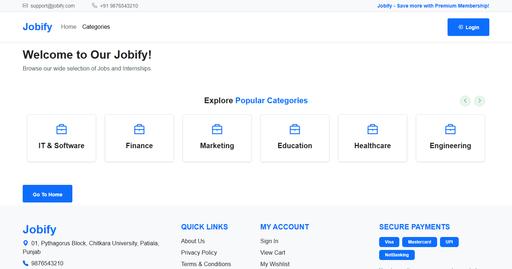 | 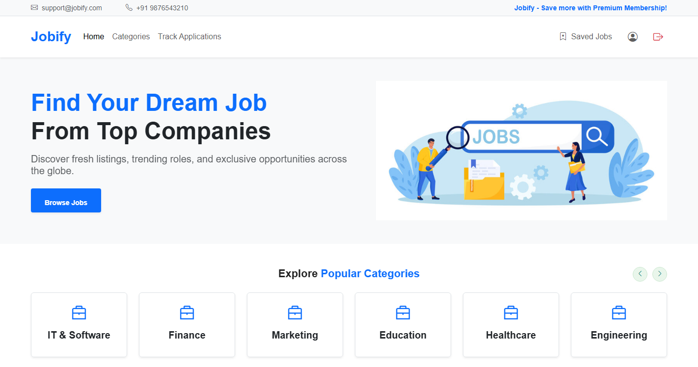 |

| Job Detail | Category Filter (IT & Software) |
|:---:|:---:|
| 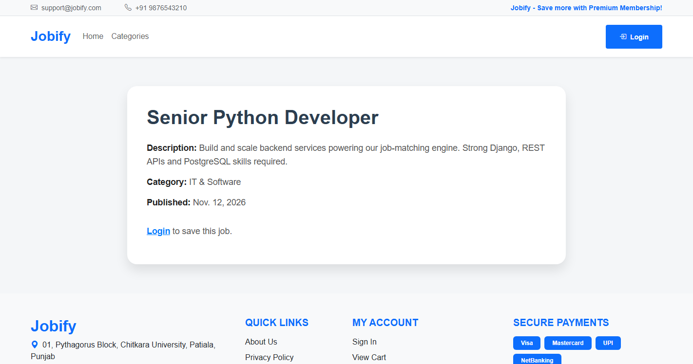 | 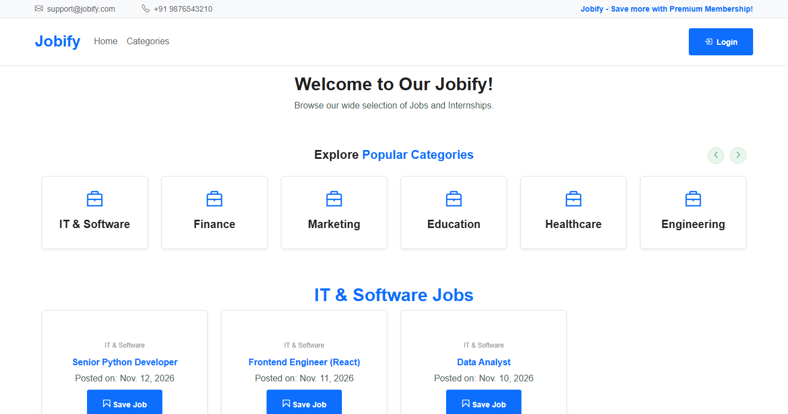 |

### Authentication

| Login | Register |
|:---:|:---:|
| 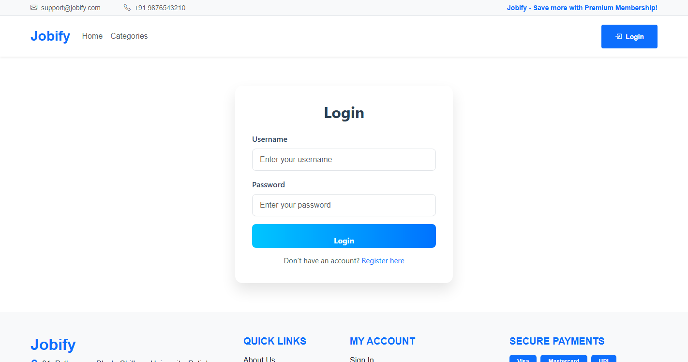 | 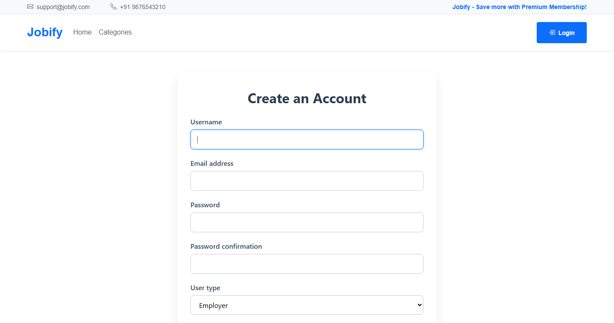 |

### Job Seeker Workflow

| Saved Jobs (Shortlist) | My Applications |
|:---:|:---:|
| 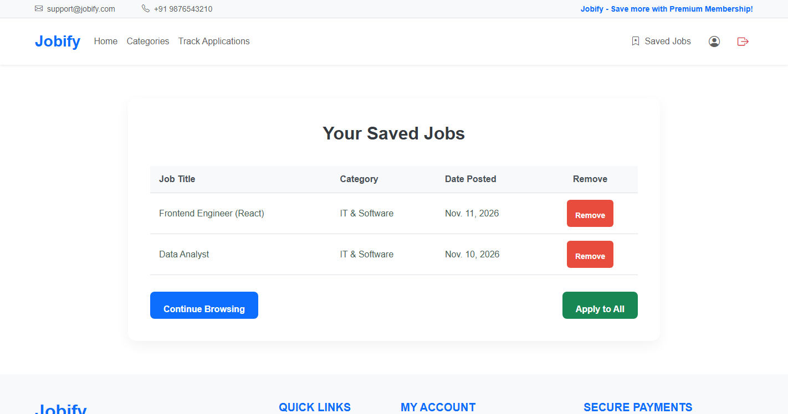 | 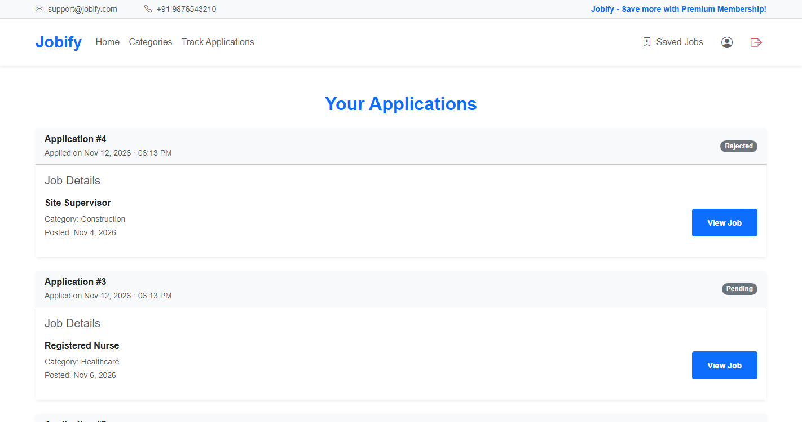 |

| User Dashboard | Profile |
|:---:|:---:|
| 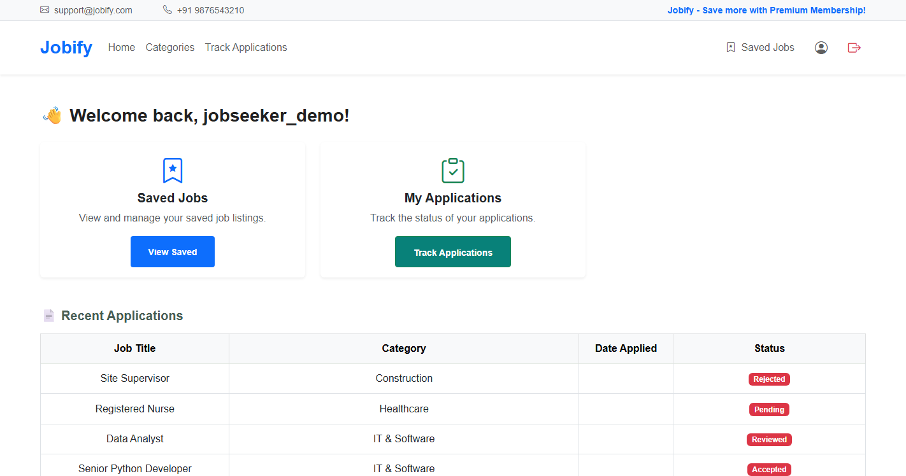 | 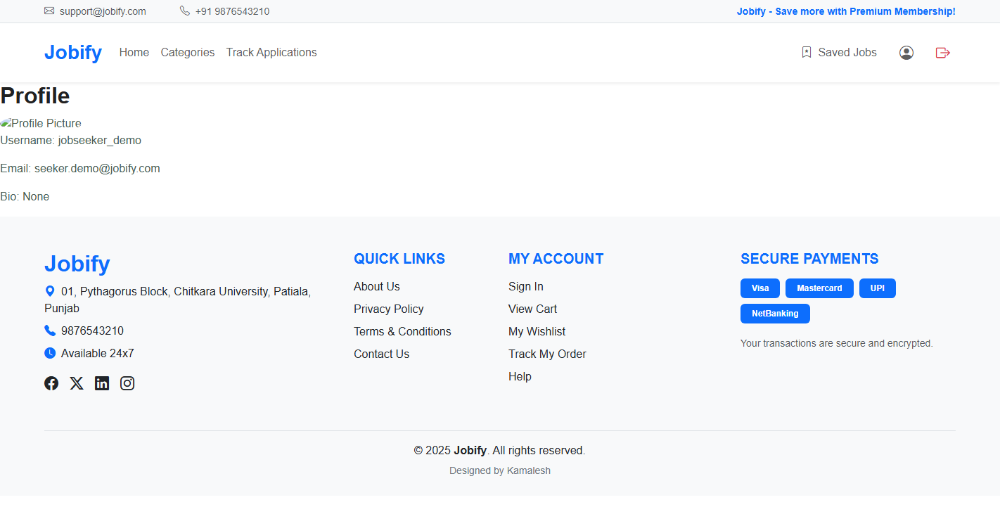 |

### Employer / Admin Workflow

| Employer Dashboard | Manage Applications |
|:---:|:---:|
| 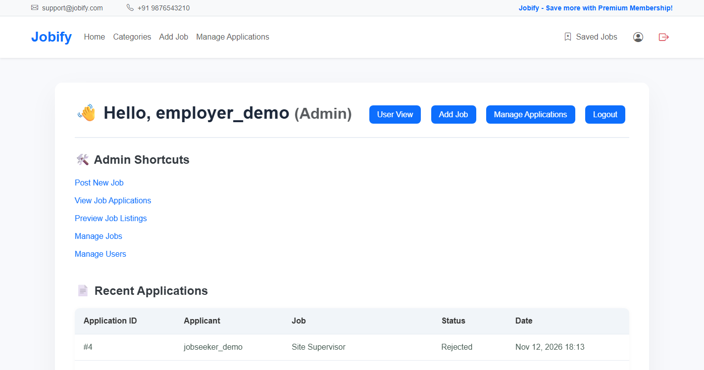 | 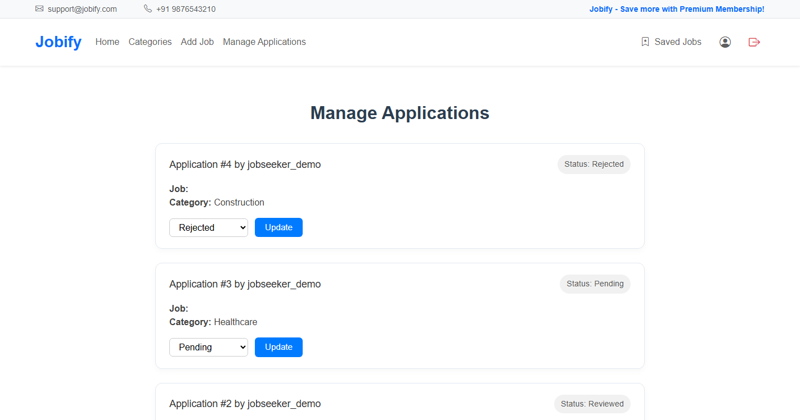 |

| Post a New Job | Manage Jobs |
|:---:|:---:|
| 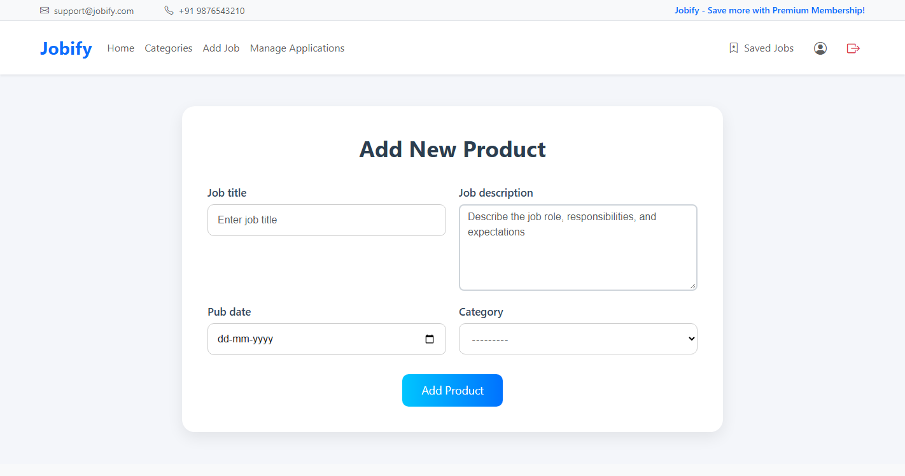 | 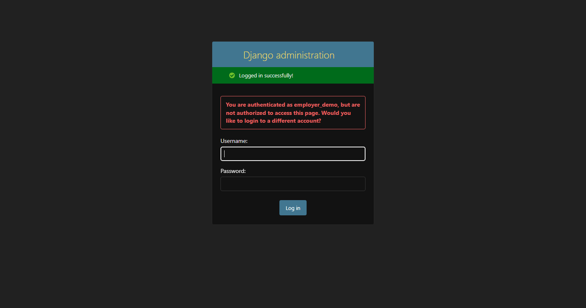 |

---

## 🛠️ Tech Stack

| Layer | Technology |
|---|---|
| Backend | Python 3.12, Django 5.2 |
| Database | SQLite 3 |
| Frontend | HTML5, CSS3, Bootstrap 5 |
| UI Extras | Swiper.js, AOS (animate on scroll), Flaticon icons |
| Auth | Django Auth with a **custom user model** (`CustomUser`) supporting role-based access |
| Media | Pillow (profile picture uploads) |

---

## 📁 Project Structure

```
job-portal-django/
├── realApp/                  # Django project root
│   ├── manage.py
│   ├── db.sqlite3            # (ignored) auto-created SQLite DB
│   ├── realApp/              # Project settings package
│   │   ├── settings.py       # Custom auth model, media config, etc.
│   │   ├── urls.py           # Root URL routing
│   │   └── wsgi.py / asgi.py
│   ├── MainApp/              # Core app: jobs, saved jobs, applications
│   │   ├── models.py         # Job, SavedJobs, JobApplication
│   │   ├── views.py          # All job/employer/jobseeker views
│   │   ├── forms.py          # JobForm
│   │   ├── urls.py           # App routes
│   │   └── templates/        # Shop, dashboard, cart, admin pages...
│   └── users/                # Accounts app: registration, profile
│       ├── models.py         # CustomUser (role-based: employer / jobseeker)
│       ├── forms.py          # Registration & profile forms
│       ├── views.py          # Register, login, logout, dashboard, profile
│       └── templates/users/
├── screenshots/              # App screenshots used in this README
├── requirements.txt
└── README.md
```

---

## 🚀 Getting Started

### Prerequisites
- **Python 3.10+** installed
- **Git**

### 1. Clone the repository

```bash
git clone https://github.com/Akshat-hub7/job-portal-django.git
cd job-portal-django
```

### 2. Create & activate a virtual environment

```bash
# Windows
python -m venv env
env\Scripts\activate

# Linux / macOS
python3 -m venv env
source env/bin/activate
```

### 3. Install dependencies

```bash
pip install -r requirements.txt
```

### 4. Apply database migrations

```bash
cd realApp
python manage.py migrate
```

### 5. Create an Employer (admin) account

```bash
python manage.py createsuperuser
```

Then log in at `http://127.0.0.1:8000/login/` — accounts registered through the **Register** page can pick either the **Employer** or **Jobseeker** role at signup.

> 💡 To also unlock Django's built-in admin panel (`/admin/`), run `python manage.py createsuperuser` — the same account works, or add it via the shell:
> ```python
> from users.models import CustomUser
> u = CustomUser.objects.get(username="yourname"); u.is_staff = True; u.is_superuser = True; u.save()
> ```

### 6. Run the development server

```bash
python manage.py runserver
```

Open **http://127.0.0.1:8000/** in your browser. 🎉

---

## 🔄 How It Works

```
Employer posts a job  ──►  Job appears in public listings
                                     │
Jobseeker browses / filters ──►  saves interesting jobs ("cart")
                                     │
                       One-click "Apply" to all saved jobs
                                     │
Employer reviews applications ──►  sets status: Pending / Reviewed / Accepted / Rejected
                                     │
Jobseeker tracks live status in "My Applications"
```

1. **Employers** log in and land on the **Admin Dashboard**, where they can post jobs and see recent applications.
2. **Job seekers** register, browse listings, and **save** jobs they like.
3. From the **Saved Jobs** page, one click applies to all saved jobs — each becomes a **Job Application**.
4. The **employer** opens **Manage Applications**, reviews each one, and updates its status with a dropdown.
5. The **job seeker** watches statuses change in real time from **My Applications**.

---

## 👥 User Roles

| | Jobseeker | Employer (Admin) |
|---|:---:|:---:|
| Browse & filter jobs | ✅ | ✅ |
| View job details | ✅ | ✅ |
| Save jobs to shortlist | ✅ | — |
| Apply to jobs | ✅ | — |
| Track application status | ✅ | — |
| Post / edit / delete jobs | — | ✅ |
| Review & update applications | — | ✅ |
| View registered users | — | ✅ |

---

## 🤝 Contributing

Feel free to fork this repository, open issues, and submit pull requests. Any contributions are greatly appreciated!

## 📄 License

This project is open source and available under the [MIT License](LICENSE).
